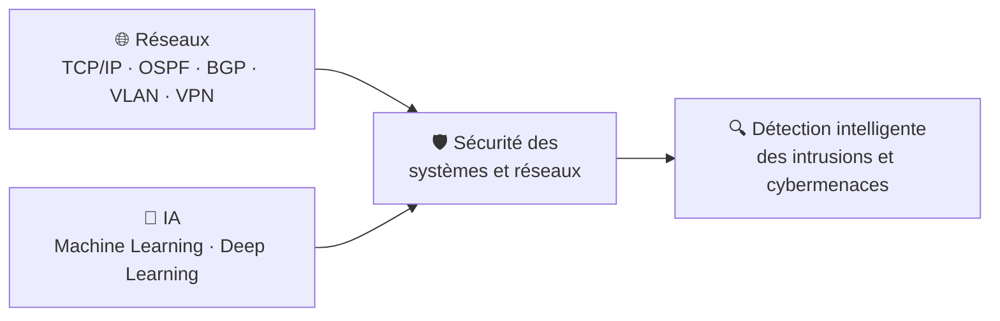

<h1 align="center">
  
</h1>

<h5 align="center">
  <code></code>
  <code></code>
</h5>

 

<h2 align="center">🚀 Bonjour, je suis Moundir Semroune</h2>

  🎓 Étudiant en Master 2 Data Science & IA | 💻 Développeur Full-Stack | 🛡️ Passionné de Réseaux & Cybersécurité

  
  
  

### 💫 À propos de moi

Je suis un développeur polyvalent, étudiant en Sciences des données et Intelligence artificielle à l'Université de Constantine 2. J'aime construire des applications complètes, du backend au mobile, mais ce qui me passionne le plus, c'est ce qui se passe *en dessous* : les réseaux qui les font communiquer et la sécurité qui les protège. Mon fil conducteur : utiliser l'IA et les données pour rendre ces systèmes plus intelligents et plus sûrs.

* 🛡️ **Ce qui me motive** : les réseaux et la sécurité des systèmes informatiques. Je m'y forme en autonomie (Packet Tracer, VMware, Linux/Kali) et je veux y appliquer l'IA pour détecter les intrusions et les cybermenaces.
* 🛠️ **Projets** : application web de gestion hôtelière (PMS), plateforme de gestion de restaurant avec IA, IoT et chatbot, projets de Machine Learning et de bases de données (PostgreSQL, MongoDB, Neo4j).
* 💬 **Demandez-moi** : réseaux (routage, VLAN, VPN), sécurité, IA, Python, Django, Flutter ou React.
* ⚡ **Fun fact** : j'apprends en autodidacte, et je me demande toujours comment un système pourrait être attaqué avant de me demander comment le construire.
* 📫 **Me contacter** : [mounder.semroun@univ-constantine2.dz](mailto:mounder.semroun@univ-constantine2.dz)

<h2 align="center">🔥 Langages, Outils & Compétences 🔥</h2>
 

  

  

  
  
  
  
  
  
  
  
  
  
   
  
  
  
  
  
  
  
   
  
  
  
  
  
  

<h2 align="center">🛡️ Réseaux & Cybersécurité 🛡️</h2>
 

  <i>Comprendre comment l'information circule, pour mieux la protéger.</i>

* 🌐 **Mes bases réseaux** : routage dynamique (OSPF, EIGRP, RIP, BGP), commutation (VLAN, STP), redondance (HSRP) et tunnels VPN, que je pratique en simulation avec **Cisco Packet Tracer**, **VMware** et **Windows Server**.
* 🐧 **Environnement de travail** : ligne de commande **Linux**, avec **Kali Linux** pour me familiariser avec l'univers de la sécurité offensive et défensive.
* 🤖 **Là où l'IA rencontre la sécurité** : le Machine Learning et le Deep Learning permettent de repérer des comportements anormaux dans un trafic réseau. C'est la direction que je souhaite approfondir : la **détection intelligente des intrusions et des cybermenaces**.

<h2 align="center">🚀 Projets 🚀</h2>
 

### 🏨 Application Web de Gestion Hôtelière (PMS) — Projet de fin de licence (2024-2025)
Système de gestion immobilière pour le secteur hôtelier : réservations, maintenance et paie. Architecture modulaire avec mécanismes d'ordonnancement et de gestion des conflits pour optimiser l'utilisation des ressources.
`Node.js` `React` `Flutter` `MySQL`

### 🍽️ Plateforme intelligente de gestion de restaurant basée sur l'IA et l'IoT (2024-2025)
Gestion des commandes, des réservations et des stocks, avec capteurs IoT et chatbot basé sur l'IA pour améliorer l'expérience utilisateur et automatiser les processus.
`React (TypeScript)` `Django` `IoT` `Chatbot IA`

### 🤖 Prédiction du revenu annuel (> 50K$) — Machine Learning, Master 1 (2025-2026)
Classification binaire : prétraitement des données, gestion des valeurs manquantes, comparaison de plusieurs algorithmes et analyse de l'impact des méthodes d'imputation sur les performances.
`Python` `Scikit-learn` `Jupyter`

### 🗄️ Projets avancés en bases de données — Master 1 (2025-2026)
- **Relationnel (PostgreSQL)** : conception et optimisation, requêtes SQL avancées
- **NoSQL (MongoDB)** : pipelines d'agrégation
- **Graphe (Neo4j)** : graphe de connaissances avec requêtes Cypher

<h4 align="center">
  <a href="https://github.com/mounder10-Se?tab=repositories" title="Voir les dépôts">🔎 Voir tous mes dépôts 🔍</a>
</h4>

<h2 align="center">⚡ Statistiques GitHub ⚡</h2>
 

  
  

  

  

  <i>« Apprendre, protéger, innover. »</i> 🛡️

